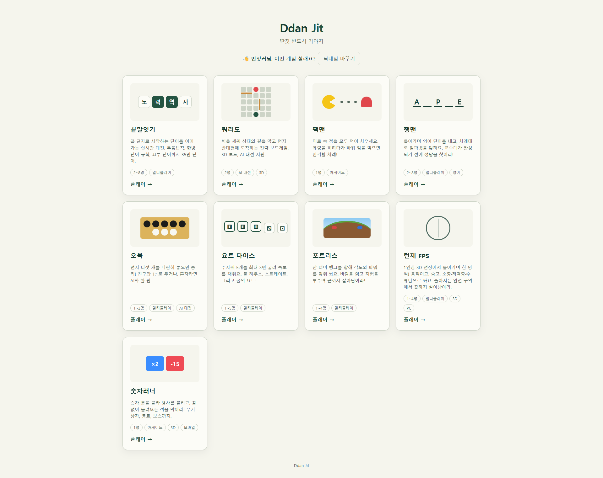
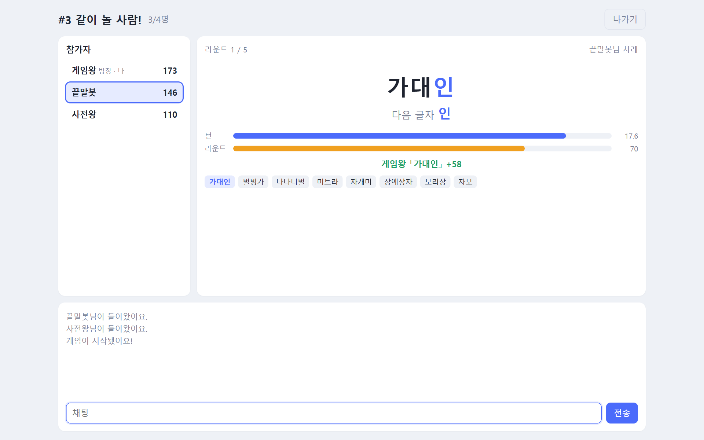
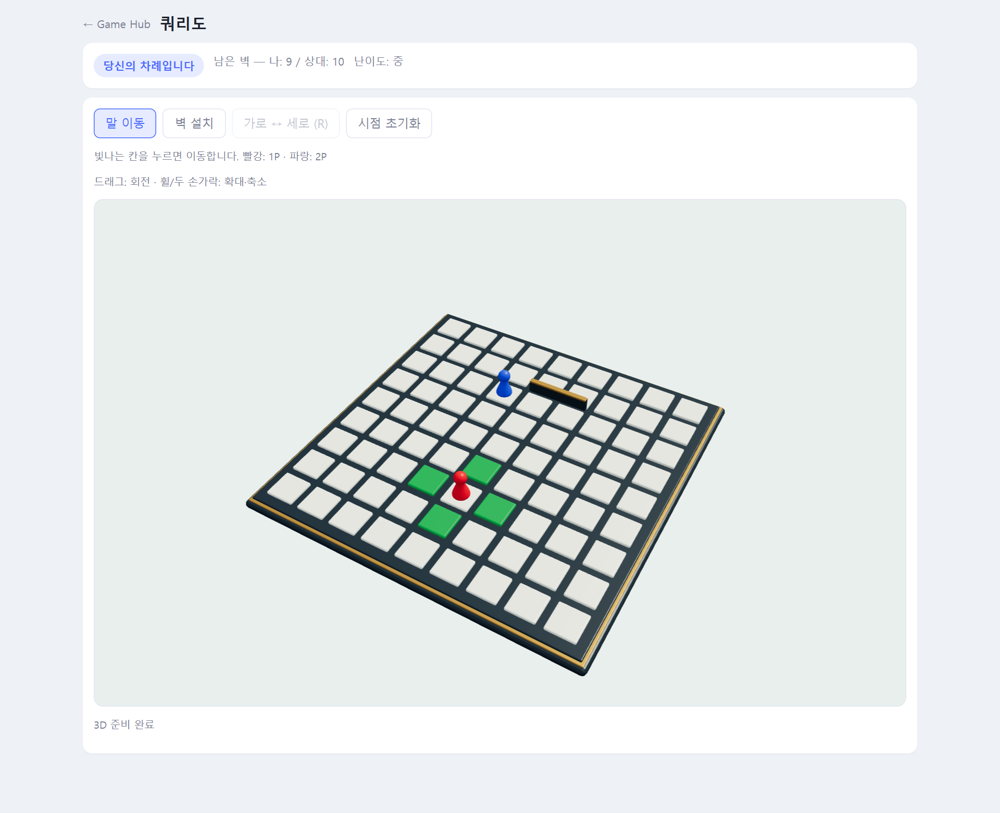
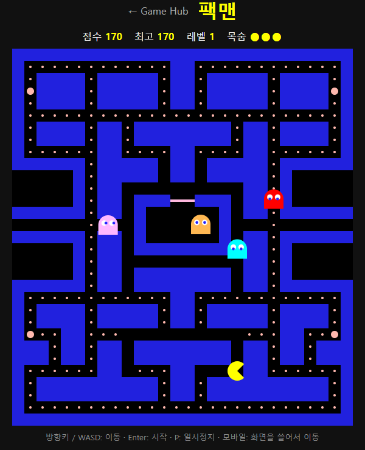
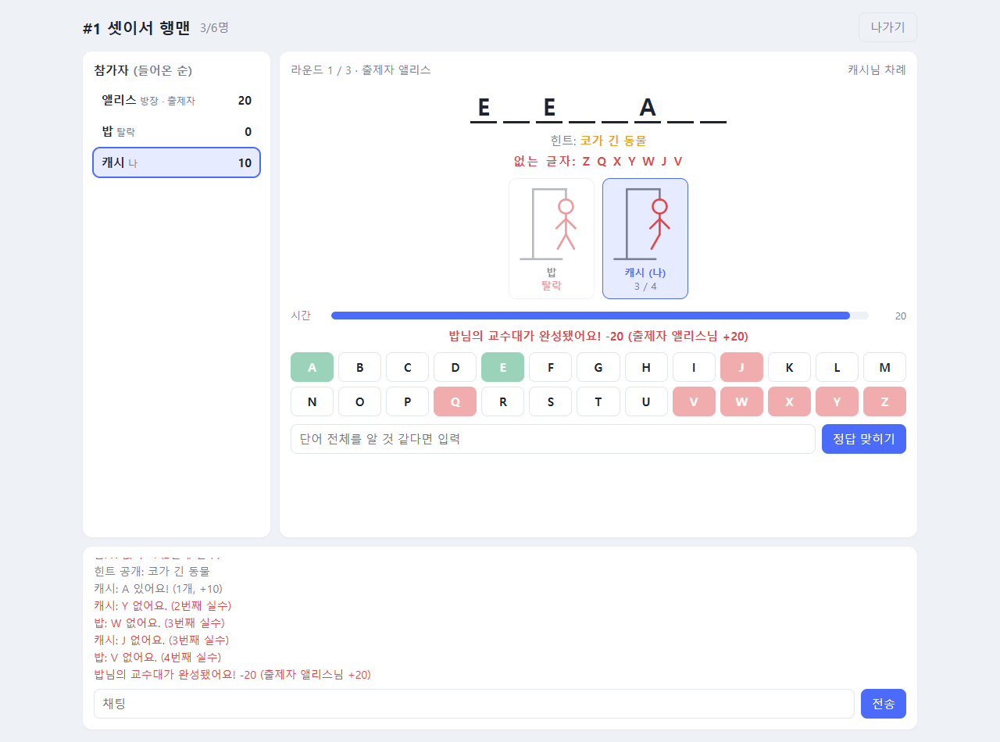
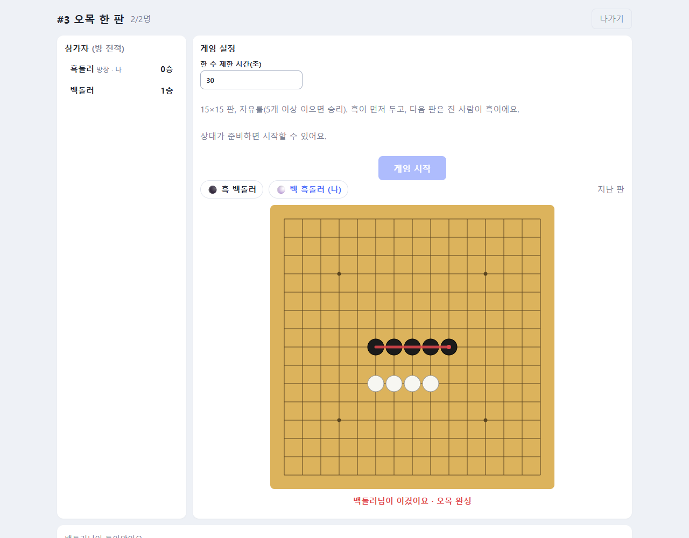
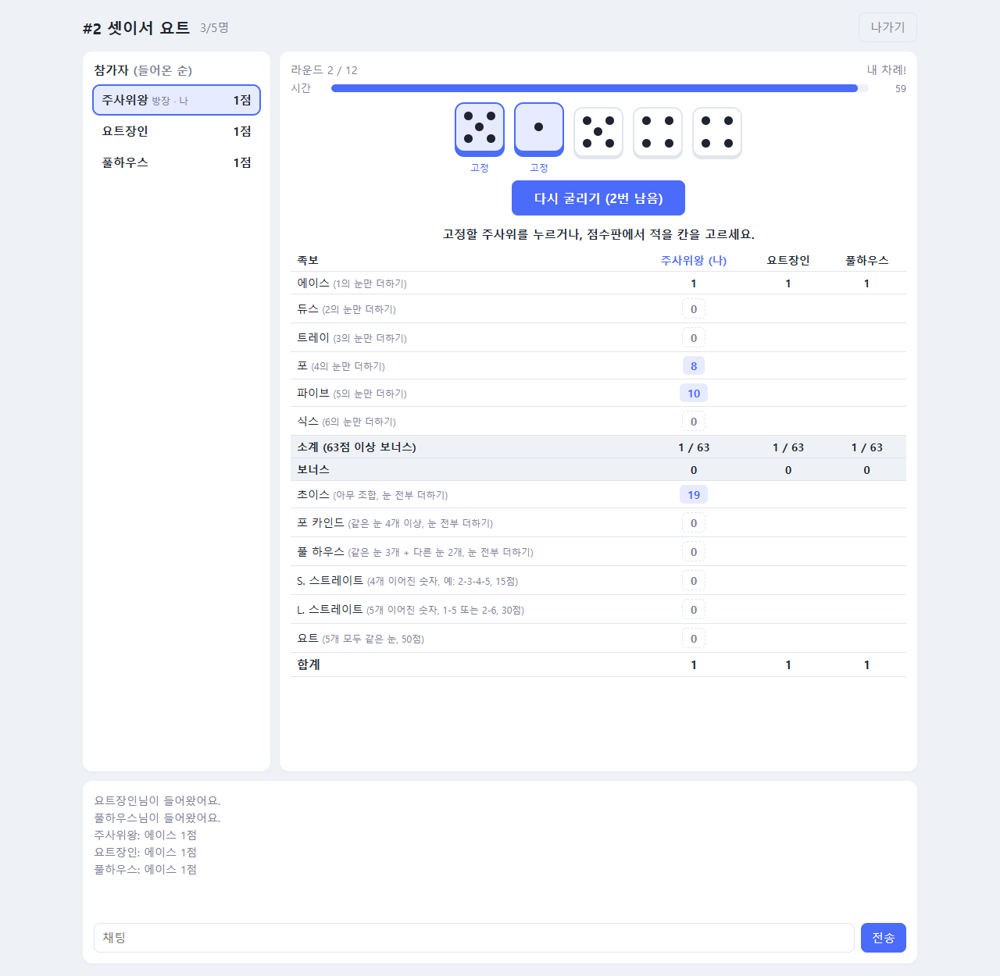
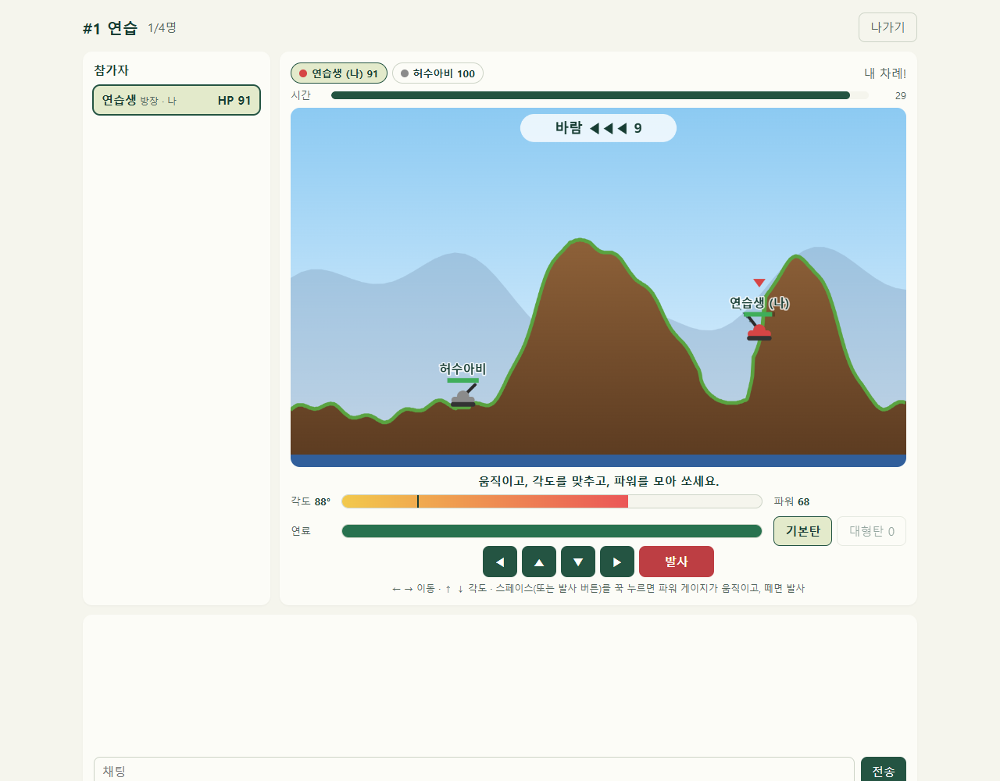
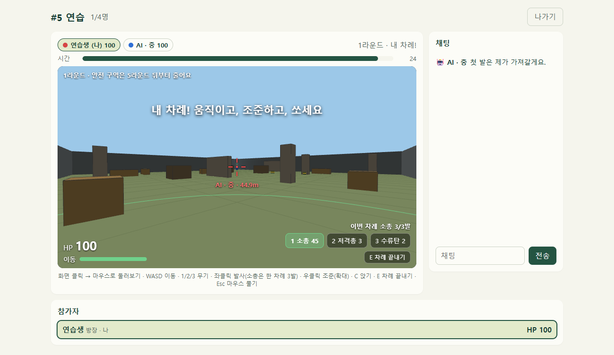
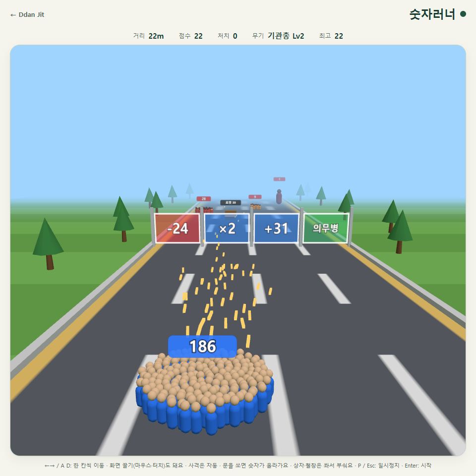

# 🎮 Ddan Jit

**딴짓 반드시 가야지. 설치도, 가입도 없이 링크 하나로 친구들과 바로 한 판.**

### [▶ 지금 플레이하기](http://ddanjit.duckdns.org)

---

## 게임

모두 16개, 멀티플레이 10개와 혼자 하는 게임 5개(박스헤드는 혼자도 같이도 돼요)가 있어요. 멀티 게임도 대부분 혼자 들어가면 AI나 연습 상대와 할 수 있어요.

| | 게임 | 인원 | 한 줄 소개 |
|:-:|---|:-:|---|
| 🔤 | **[끝말잇기](wordchain/README.md)** | 2~8명 | 35만 단어 사전으로 겨루는 실시간 끝말잇기 |
| 🧱 | **[쿼리도](quoridor/README.md)** | 1~2명 | 벽을 세워 길을 막는 3D 전략 보드게임 |
| 🟡 | **[팩맨](pacman/README.md)** | 1명 | 유령을 피해 미로 속 점을 먹어 치우는 아케이드 |
| 🔠 | **[행맨](hangman/README.md)** | 2~8명 | 돌아가며 영어 단어를 내고 차례대로 맞히는 추리 게임 |
| ⚫ | **[오목](omok/README.md)** | 1~2명 | 다섯 개를 먼저 잇는 사람이 이기는 두뇌 게임, AI 5단계 |
| 🎲 | **[요트 다이스](yacht/README.md)** | 1~5명 | 주사위 5개를 3번까지 굴려 족보를 채우는 주사위 게임 |
| 💥 | **[포트리스](fortress/README.md)** | 1~4명 | 각도와 파워를 맞춰 산 너머 탱크를 맞히는 턴제 포격전 |
| 🎯 | **[턴제 FPS](shooter/README.md)** | 1~4명 | 1인칭 3D 아레나에서 돌아가며 쏘는 턴제 슈팅, AI 대전 |
| 🃏 | **[홀덤](holdem/README.md)** | 2~8명 | 3D 포커 테이블에서 겨루는 노리밋 텍사스 홀덤 토너먼트 |
| 🎴 | **[섯다](seotda/README.md)** | 2~6명 | 세 장 받아 두 장 고르는 섯다. 광땡·땡·끗, 땡잡이·암행어사·구사 재경기 |
| 🌸 | **[고스톱](gostop/README.md)** | 1~3명 | 혼자 AI와 맞고, 친구와 3인 고스톱. 쪽·뻑·폭탄·흔들기, 피박·광박 |
| 🧟 | **[박스헤드](boxhead/README.md)** | 1~4명 | 네모 머리로 좀비·악마를 막는 탑다운 슈팅, 혼자 점수 경쟁 또는 협동 |
| 🏃 | **[숫자러너](runner/README.md)** | 1명 | 숫자 문을 골라 병사를 불리고 끝없는 적을 막는 3D 러너 |
| 🏓 | **[탁구](pingpong/README.md)** | 1명 | 휘둘러서 드라이브·스매시·커트, 회전이 걸린 공으로 AI와 11점 승부 |
| 🐔 | **[길건너기](crossy/README.md)** | 1명 | 차·기차를 피하고 통나무를 타며 한 칸씩 끝없이 건너는 3D 아케이드 |
| 🍎 | **[사과게임](apple/README.md)** | 1명 | 네모로 묶은 숫자 합이 10이면 사라지는 2분 퍼즐 (원조 Fruit Box 규칙) |

### 🔤 끝말잇기

끝 글자를 이어 가며 제한 시간 안에 단어를 대는 실시간 대전입니다.
**표준국어대사전과 끄투 단어를 합친 35만 단어**로 판정하고, 두음법칙(력 → 역)과 한방단어 규칙까지 챙겼어요.
빨리 칠수록, 긴 단어일수록 점수가 올라갑니다.

[게임 설명 보기 →](wordchain/README.md)

### 🧱 쿼리도

말을 한 칸씩 움직이거나 벽을 세워서, 상대보다 먼저 반대편 끝에 도착하면 이기는 전략 보드게임입니다.
돌리고 확대할 수 있는 **3D 보드**에서 친구와 1:1로 붙거나 **AI**(하·중·상)와 대결할 수 있어요.
AI가 한 수 한 수를 어떻게 평가하는지 보여주는 **학습 모드**도 있습니다.

[게임 설명 보기 →](quoridor/README.md)

### 🟡 팩맨

유령 네 마리를 피해 미로 속 점을 모두 먹어 치우는 고전 아케이드 게임입니다.
파워 점을 먹으면 잠깐 동안 유령을 거꾸로 잡아먹을 수 있어요. 레벨이 오를수록 빨라집니다.

[게임 설명 보기 →](pacman/README.md)

### 🔠 행맨

한 명이 영어 단어를 내면, 나머지가 차례대로 알파벳을 골라 맞히는 게임입니다.
교수대는 사람마다 하나씩, 틀릴 때마다 내 교수대에 한 획씩 그려져요. 먼저 매달리면 탈락!
모두가 돌아가며 출제자가 되고, 추측이 길어지면 힌트가 열립니다.

[게임 설명 보기 →](hangman/README.md)

### ⚫ 오목

가로, 세로, 대각선으로 다섯 개를 먼저 이으면 이기는 고전 게임입니다.
친구와 1:1로 두거나, 혼자라면 **AI(하·중·중상·상·최상)**와 둘 수 있어요. AI는 내가 둔 수를 평가해서 채팅으로 한마디씩 해요.
방 안에서 전적이 쌓이고, 다음 판은 진 사람이 흑으로 먼저 둡니다.

[게임 설명 보기 →](omok/README.md)

### 🎲 요트 다이스

차례마다 주사위 5개를 최대 3번 굴리고, 마음에 드는 주사위는 고정해 가며 족보를 채우는 게임입니다.
풀 하우스, 스트레이트, 그리고 50점짜리 요트까지! 주사위가 굴러가는 모습을 모두가 함께 봐요.

[게임 설명 보기 →](yacht/README.md)

### 💥 포트리스

돌아가며 탱크를 움직이고, 각도를 맞추고, 파워 게이지를 모아 쏘는 턴제 포격전입니다.
바람은 차례마다 바뀌고, 포탄이 떨어진 자리는 땅이 파여요. 발밑을 파서 상대를 바다에 빠뜨릴 수도 있어요!
혼자라면 허수아비로 연습하거나 **AI(하·중·상)**와 대결할 수 있어요.

[게임 설명 보기 →](fortress/README.md)

### 🎯 턴제 FPS

1인칭 3D 아레나에서 돌아가며 한 명씩 움직이고, 둘러보고, 쏘는 턴제 슈팅입니다. 소총은 한 차례 3발, 저격총·수류탄은 1발.
엄폐물 뒤에 앉아 숨고, 헤드샷을 노리고, 수류탄으로 숨은 상대를 끌어내세요. 보급 상자로 탄약과 체력을 채우고,
6라운드부터 좁아지는 안전 구역 안에서 끝까지 살아남으면 승리! 혼자라면 AI(하·중·상)와 대결해요. (PC 전용)

[게임 설명 보기 →](shooter/README.md)

### 🃏 홀덤

3D 포커 테이블에 2~8명이 둘러앉아 같은 칩으로 시작하는 노리밋 텍사스 홀덤 토너먼트입니다.
폴드·체크·콜·레이즈·올인, 사이드 팟까지 진짜 규칙 그대로. 블라인드가 점점 오르고 마지막 1명이 남으면 우승!
족보는 버튼으로 펼치고 접을 수 있어요. AI 없이 사람끼리만 해요. (PC·모바일)

[게임 설명 보기 →](holdem/README.md)

### 🎴 섯다

화투 1~10월 20장으로 하는 세 장 섯다예요. 판돈을 내고 두 장 받아 첫 베팅, 한 장 더 받아 세 장 중 두 장을 고른 뒤 마지막 베팅(다이·체크·삥·콜·하프·따당)을 하고 공개해요.
땡잡이·암행어사·구사 재경기까지 들어 있고, 판이 끝나면 모두의 패와 족보를 결과 카드로 보여 줘요. (PC·모바일)

[게임 설명 보기 →](seotda/README.md)

### 🌸 고스톱

화투 48장으로 하는 맞고(2명·7점)와 고스톱(3명·3점)이에요. 사람이 모자라면 AI가 자리를 채워서 혼자서도 바로 할 수 있어요.
쪽·뻑·따닥·쓸·폭탄·흔들기·총통, 고·스톱, 피박·광박·멍박·고박, 나가리까지 들어 있고 판마다 점수 내역을 보여 줘요. (PC·모바일)

[게임 설명 보기 →](gostop/README.md)

### 🧟 박스헤드

네모난 머리 캐릭터로 사방에서 몰려오는 좀비를 막는 탑다운 슈팅입니다. 권총·샷건·기관총, 레벨을 깰 때마다 나오는 불덩이 악마,
연속으로 잡을수록 오르는 점수 배율. 혼자 점수 경쟁(순위표)도, 2~4명 협동도 돼요. WASD 8방향 이동에 마우스 조준, 스페이스 발사. (PC·모바일)

[게임 설명 보기 →](boxhead/README.md)

### 🏃 숫자러너

4칸 도로를 옮겨 다니며 `+20`, `×2`, `-15` 같은 숫자 문을 골라 병사를 불리고, 앞에서 끝없이 몰려오는 적을 막는 3D 러너입니다.
무기 상자를 쏴서 무기를 바꾸고, 철창 속 포로와 동료를 모으고, 1000m마다 나오는 보스를 쓰러뜨리세요. (PC·모바일)

[게임 설명 보기 →](runner/README.md)

### 🏓 탁구

3D 탁구대에서 AI(하·중·상)와 11점 승부를 겨루는 1인용 탁구입니다.
라켓을 앞으로 휘두르면 드라이브, 높은 공을 세게 치면 스매시, 뒤로 당기면 커트. 공에 회전이 걸려서 휘고, 튄 뒤 뻗거나 멈칫해요. (PC·모바일)

[게임 설명 보기 →](pingpong/README.md)

### 🐔 길건너기

닭을 한 칸씩 뛰게 해서 도로의 차, 철길의 기차를 피하고 통나무와 연잎을 밟아 강을 건너는 끝없는 3D 아케이드입니다.
가만히 있거나 뒤로 세 칸 가면 독수리가 잡아가요. 길에서 동전도 모아요. (PC·모바일)

[게임 설명 보기 →](crossy/README.md)

### 🍎 사과게임

1~9가 적힌 사과 170개(17×10) 위에 드래그로 네모를 그려서, 안에 든 숫자 합이 딱 10이면 사과가 사라져요.
지운 자리는 빈칸(0)으로 남아 멀리 있는 사과끼리도 묶을 수 있어요. 2분 동안 몇 개나 딸 수 있을까요? (PC·모바일)

[게임 설명 보기 →](apple/README.md)

---

## 이렇게 시작하세요

1. **[Ddan Jit](http://ddanjit.duckdns.org)에 접속**해서 하고 싶은 게임을 고릅니다.
2. **메인 화면에서 닉네임을 정합니다.** 한 번만 정하면 모든 게임에 그 이름으로 바로 들어가요. 가입도 로그인도 필요 없어요.
3. **친구에게 주소를 보내세요.** 같은 방에 들어오면 바로 시작입니다.

크롬, 엣지, 사파리 같은 최신 브라우저에서 동작합니다. 앱을 설치할 필요는 없어요.

## 자주 묻는 질문

<b>회원가입을 해야 하나요?</b>

아니요. 메인 화면에서 닉네임만 한 번 정하면 모든 게임에 바로 들어갈 수 있어요. 닉네임은 이 브라우저에만 저장되고, 메인 화면의 **닉네임 바꾸기**로 언제든 바꿀 수 있어요.

<b>점수나 전적이 저장되나요?</b>

**길건너기·사과게임·박스헤드(혼자 하기)·숫자러너·팩맨**은 점수가 서버 순위표에 올라가요. 메인 화면 아래 **🏆 순위**와 각 게임 결과 창에서 이번 주·전체 상위 10명을 볼 수 있어요(허브 닉네임으로 올라가고, 이번 주 순위는 매주 월요일 0시에 새로 시작). 그 밖의 전적은 아직 저장하지 않아요. 탁구 난이도별 전적과 길건너기 동전은 내 브라우저에만 저장돼요.
서버를 점검하면 진행 중인 방도 초기화돼요.

<b>순위에 "이 닉네임은 다른 브라우저에서 쓰고 있어요"라고 나와요</b>

순위표 닉네임은 **처음 점수를 올린 브라우저의 것**이 돼요. 남이 내 이름으로 기록을 올리지 못하게 하려는 거예요.
다른 컴퓨터·폰이나 브라우저 데이터를 지운 뒤에는 같은 닉네임을 다시 못 써요. 그럴 땐 다른 닉네임을 쓰거나 운영자에게 풀어 달라고 말해 주세요.
(점수는 판을 시작할 때 서버가 받아 둔 시간으로 검사해요. 오래 켜 둔 화면에서 "새로고침하고 다시 해 주세요"가 나오면 새로고침하면 돼요.)

<b>"이미 접속 중인 닉네임"이라고 떠요.</b>

같은 닉네임을 다른 사람이 쓰고 있거나, 다른 기기에서 접속한 연결이 아직 남아 있는 경우예요.

- **같은 브라우저**라면 다시 입장할 때 예전 연결을 자동으로 이어받아요.
- **다른 기기**에서 쓰던 닉네임이라면 1분 정도 뒤에 다시 시도해 주세요.

<b>화면이 이상하거나 예전 모습 그대로예요.</b>

업데이트 직후라면 브라우저가 예전 화면을 기억하고 있을 수 있어요.
<kbd>Ctrl</kbd> + <kbd>F5</kbd>(맥은 <kbd>Cmd</kbd> + <kbd>Shift</kbd> + <kbd>R</kbd>)로 새로고침해 주세요.

<b>끝말잇기에서 욕도 인정되나요?</b>

표준국어대사전이나 끄투 단어에 **실려 있는 말이면 인정**돼요. 사전에 없는 비속어는 인정하지 않아요.
모르는 사람과 할 때는 매너를 지켜 주세요.

<b>게임 중인 방도 구경할 수 있나요?</b>

네, 끝말잇기·행맨·오목·요트 다이스·포트리스·턴제 FPS는 로비에서 **"게임 중 · 관전하기"**가 붙은 방(또는 꽉 찬 방)을 누르면 구경할 수 있어요. 구경하는 동안 말하는 건 되지만(채팅에 "관전" 표시가 붙어요), 게임에는 끼어들 수 없어요. 쿼리도는 메뉴의 **"코드로 관전"**에 방 코드를 넣으면 돼요. 팩맨, 숫자러너, 탁구, 길건너기, 사과게임, 박스헤드 혼자 하기는 혼자 하는 게임이라 구경할 게 없어요.

## 업데이트 소식

| 날짜 | 내용 |
|---|---|
| 2026-10-28 | 🌸 **고스톱 추가** (맞고·3인, AI 채우기, 쪽·뻑·따닥·쓸·폭탄·흔들기·총통, 박·고박·나가리, PC·모바일) |
| 2026-10-29 | 🎴 **섯다를 세 장 섯다로** (두 장 받고 첫 베팅 → 한 장 더 → 세 장 중 두 장 고르기 → 마지막 베팅, 고를 때 족보 미리 보기) |
| 2026-10-28 | 🎴 **섯다 추가** (2~6명, 두 장 섯다, 특수패·재경기, 화투 그림, PC·모바일) |
| 2026-10-14 | 🧟 **박스헤드 추가** (혼자 점수 경쟁·순위표, 2~4명 협동, 좀비·악마, 권총·샷건·기관총, PC·모바일) |
| 2026-10-14 | 🃏 **홀덤 추가** (2~8명 3D 토너먼트, 사이드 팟, 족보 펼치기, PC·모바일) |
| 2026-10-14 | 🍎 **사과게임 추가** (원조 규칙 17×10·2분, 순위표, PC·모바일) |
| 2026-10-13 | 🏆 **순위표**: 길건너기·숫자러너·팩맨 이번 주·전체 상위 10명 |
| 2026-10-12 | 🐔 **길건너기 추가** (1인용, 도로·철길·강, 독수리, 동전, PC·모바일) |
| 2026-10-12 | 🏓 **탁구 추가** (1인용, AI 하·중·상, 드라이브·스매시·커트·블록, 회전, PC·모바일) |
| 2026-10-11 | 🧹 AI의 욕설 말투와 끝말잇기의 사전 밖 비속어를 모두 뺐어요 |
| 2026-10-10 | 🏃 **숫자러너 추가** (1인용, 4칸 도로 숫자 문, 무기·동료·포로·보스, PC·모바일) |
| 2026-10-09 | 🎯 **턴제 FPS 추가** (1~4명, 1인칭 3D, AI 대전, 안전 구역·보급 상자·앉기) |
| 2026-10-06 | 💬 오목·포트리스 **AI가 채팅으로 말을 걸어요** (수 평가, 명중, 승패, 채팅 대꾸) |
| 2026-10-06 | 👋 메인 화면에서 **닉네임을 한 번만** 정하면 모든 게임에 바로 들어가요 |
| 2026-10-02 | 💥 포트리스 **AI 대전**(하·중·상), WASD·스페이스 조작, 디자인 개편 |
| 2026-10-01 | 💥 **포트리스 추가** (1~4명, 바람, 지형 파괴) |
| 2026-10-01 | ⚫ 오목 **AI 난이도 5단계** (하·중·중상·상·최상) |
| 2026-10-01 | 🎨 **Ddan Jit**으로 이름을 바꾸고 모든 게임 색상 통일 |
| 2026-10-01 | 👀 **관전 기능**: 게임 중인 방을 구경할 수 있어요 (끝말잇기·행맨·오목·요트 다이스·쿼리도) |
| 2026-10-01 | 🎲 **요트 다이스 추가** (1~5명, 주사위 애니메이션) |
| 2026-10-01 | ⚫ **오목 추가** (1:1 대전, AI 대전) |
| 2026-10-01 | 🟡 팩맨 **난이도 4단계** (쉬움 · 보통 · 중상 · 어려움) |
| 2026-10-01 | 🔤 끝말잇기 사전에 **끄투 단어 추가** (21만 → 35만), 어인정 단어 옵션 |
| 2026-10-01 | 🔠 **행맨 추가** (2~8명, 돌아가며 출제) |
| 2026-10-01 | 🟡 **팩맨 추가** (1인용) |
| 2026-09-30 | 🎉 **Game Hub 오픈**: 끝말잇기와 쿼리도를 한곳에서 |
| 2026-09-30 | 두 게임 디자인 통일, 끝말잇기 단어 착지 효과 |
| 2026-09-30 | 끝말잇기 닉네임 중복 접속 방지, 빈 방 자동 정리 |
| 2026-09-29 | 끝말잇기 사전을 **표준국어대사전 21만 단어**로 확장, 비속어 인정 |
| 2026-09-29 | 끝말잇기 첫 공개: 로비, 방, 두음법칙, 한방단어 규칙 |
| 2026-09-26 | 쿼리도 **3D 보드**와 캐릭터 애니메이션 |

## 준비 중

- 🔤 끝말잇기: 맞힌 단어의 뜻풀이 보여주기, 쿵쿵따·앞말잇기 모드
- 🧱 쿼리도: 온라인 대전 재접속
- 🟡 팩맨: 보너스 과일, 친구와 점수 겨루기
- 🏃 숫자러너: 친구와 같은 맵으로 동시에 달리는 대결
- 🏓 탁구: 친구와 같은 조건으로 AI를 상대해 점수 겨루기
- 🎮 Ddan Jit: 새로운 게임 추가

하고 싶은 게임이나 불편한 점이 있다면 [이슈](https://github.com/kminh-wow/Game_hub/issues)로 알려 주세요.

## 출처

- 끝말잇기 사전: 국립국어원 [표준국어대사전](https://stdict.korean.go.kr), [KKuTu](https://github.com/JJoriping/KKuTu) 단어 DB (GPL v3, 단어만 사용)
- 행맨 영어 사전: ENABLE word list (퍼블릭 도메인)
- 3D 렌더링: [three.js](https://threejs.org) (MIT License)
- 탁구 에셋: 경기장 HDRI [Poly Haven](https://polyhaven.com/a/circus_arena), 나무 바닥 [ambientCG](https://ambientcg.com), 로봇 선수 [Kenney Blocky Characters](https://kenney.nl/assets/blocky-characters) (모두 CC0, [자세히](pingpong/web/assets/CREDITS.md))

 

개발 참여나 직접 서버를 띄우는 방법은 [개발 문서](docs/DEVELOPMENT.md)에 있어요.
