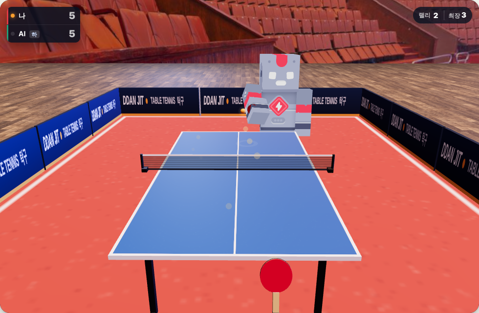

# 🏓 탁구 (Ping Pong)

**라켓을 앞으로 휘둘러 드라이브! 회전이 걸린 공으로 AI와 11점 승부**

### [▶ 지금 플레이하기](http://ddanjit.duckdns.org/pingpong/)

---

## 이런 게임이에요

실제 경기장 같은 3D 탁구장에서 **로봇 선수 AI(하·중·상)** 와 겨루는 1인용 탁구예요.
마우스나 손가락으로 라켓을 움직이고, 공이 올 때 **휘두르는 방향과 세기**로 샷이 정해져요.
공에는 진짜처럼 **회전**이 걸려서 탑스핀은 아래로 휘며 튄 뒤 쭉 뻗고, 백스핀은 떠 있다가 튄 뒤 멈칫해요.

- 🏓 **11점 먼저**, 10:10부터는 **2점 차**로 이겨야 해요
- 🔄 서브는 **2점마다** 바뀌어요 (10:10부터는 1점마다)
- 🎯 내 쪽으로 오는 공은 **떨어질 자리**가 흰 동그라미로 보여요
- 📱 **PC·모바일** 모두 (모바일은 화면을 끌어서)
- 🏆 난이도별 **전적**이 이 브라우저에 저장돼요

## 조작

| 입력 | 하는 일 |
|:-:|---|
| 마우스 움직이기 / 화면 끌기 | 라켓 움직이기 (화면 위쪽 = 네트 쪽) |
| 공이 올 때 **앞으로** 휘두르기 | 드라이브 (빠를수록 세고 회전이 많음) |
| 높이 뜬 공을 **세게** 앞으로 | 스매시 |
| 공이 올 때 **뒤로** 당기기 | 커트 (백스핀, 느리고 낮게) |
| 가만히 대기 | 블록 (들어온 힘을 받아서 넘김) |
| 옆으로 휘두르기 | 그쪽으로 보내기 |
| 클릭 / 스페이스 / 손 떼기 | 서브 (그때 휘두르던 방향으로 회전이 걸려요) |
| P / Esc | 일시정지 |
| M | 소리 끄기·켜기 |

## 샷

| 샷 | 속도 | 회전 | 특징 |
|---|---|---|---|
| 드라이브 | 빠름 | 탑스핀 많이 | 기본 공격. 아래로 휘어서 세게 쳐도 잘 들어가요 |
| 스매시 | 아주 빠름 | 조금 | 높이 뜬 공(네트 위로 한참)에만. 실수가 커요 |
| 블록 | 들어온 만큼 | 들어온 회전을 조금 | 탑스핀 공을 막으면 길어지기 쉬워요 |
| 커트 | 느림 | 백스핀 | 백스핀 공을 약하게 치면 짧아져서 네트에 걸리기 쉬워요 |

- **라켓 가운데**에 맞을수록 정확해요. 가장자리에 맞으면 엉뚱한 데로 가요.
- **너무 낮게**(탁구대 높이 아래로) 떨어진 공을 치면 짧아져요. 앞으로 나가서 높을 때 치세요.
- 세게 칠수록 조금씩 더 흔들려요.

## 점수가 나는 경우

| 이유 | 점수 |
|---|---|
| 친 공이 상대 쪽에 안 튀고 나감 (아웃) | 상대 |
| 친 공이 네트에 걸림 | 상대 |
| 받는 쪽에 두 번 튐, 또는 못 받고 지나감 | 친 사람 |
| 서브가 내 쪽 → 상대 쪽 순서로 안 튐 | 상대 (서브는 늘 규칙대로 들어가서 거의 없어요) |

## 난이도

| 난이도 | 특징 |
|---|---|
| 하 | 느리게 움직이고 반응이 늦어요. 실수가 많고 약하게 쳐요 |
| 중 | 웬만한 공은 다 받고, 가끔 구석을 노려요 |
| 상 | 빠르고 정확해요. 높은 공은 거의 스매시, 라켓 반대쪽을 노려요 |

---

[← Game Hub로 돌아가기](../README.md)
